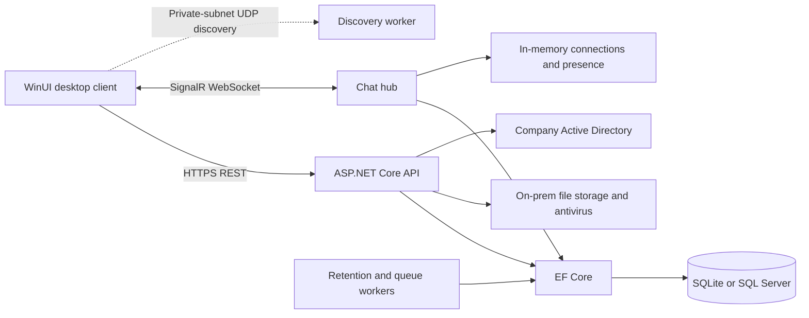

# Architecture and database

## Components



The client sends credentials or performs optional Windows Negotiate authentication over trusted HTTPS. The server issues an RSA-signed access token and a rotating refresh token. Only a SHA-256 digest of the refresh token is stored. The Windows client stores its token in Credential Manager, scoped to the selected server. API and hub calls verify active account state and token version; administrator session invalidation increments that version and revokes refresh tokens.

Conversation creation stores memberships and adds existing connections to SignalR groups. Sending checks membership, content length, file ownership and reply ownership, persists the message, updates conversation activity, broadcasts it and queues delivery to offline members. Reconnect loads groups and delivers pending queue entries only while membership remains valid. Message history remains the durable source of truth.

Uploads require conversation membership, enforce extension/size limits, stream to local disk, compute SHA-256 and run the configured antivirus executable without a shell. Downloads check current membership; the client verifies hash and length into a temporary file before replacing the user-selected destination.

The server refuses wildcard/public interface bindings and applies a configurable CIDR guard to requests. Discovery binds to the same interface. The client uses a private-address connection callback for REST and WebSocket connections, bypasses proxies and does not disable certificate validation. There are no cloud storage, telemetry, update or CDN integrations.

SQLite uses WAL and serializes hub write operations to avoid blocked writer threads under concurrent traffic. SQL Server has a separate context/migration set and does not use this hub serialization. Presence is process-local, so deployment uses one server instance; multi-node operation would require shared presence and a SignalR backplane.

## Schema

| Table | Key and relationships |
|---|---|
| Users | ID; unique username/email; role, account state, token version, local password hash/salt, directory profile |
| Conversations | ID; type, name, creator, activity, retention and archive state |
| ConversationMembers | ConversationID + UserID; membership and conversation administrator flag |
| Messages | ID; conversation, sender, optional reply/file; UTC timestamps and soft-delete state |
| MessageReactions | MessageID + UserID + Emoji |
| MessageReadReceipts | MessageID + UserID |
| FileAttachments | ID; uploader, conversation, disk path, hash, size and scan outcome |
| Announcements | ID; author, priority, content, posting/expiry timestamps |
| AnnouncementAcks | AnnouncementID + UserID |
| RefreshTokens | ID; unique token digest, expiry, revocation and replacement digest |
| OfflineMessages | ID; recipient, conversation, message reference and delivery state |
| AuditLogs | ID; actor, action, outcome, remote address and UTC timestamp |

Migrations live in `src/IFB.Server/Data/Migrations` for SQLite and `Data/SqlServerMigrations` for SQL Server. SQLite sets reply references to null on deletion. SQL Server avoids cascade cycles and retention clears reply references explicitly before deletion. Backup the database, attachments and private signing key together.

## Folder structure

```text
src/IFB.Client       Desktop application, views, MVVM, services and controls
src/IFB.Server       API, hub, authentication, data, services and workers
src/IFB.Shared       Cross-process contracts and enums
tests/IFB.Tests      Executable functional/security/load suite
scripts             Development startup and release packaging
installer           Offline client and Windows Service installation scripts
docs                Architecture, design system, deployment and validation
```
